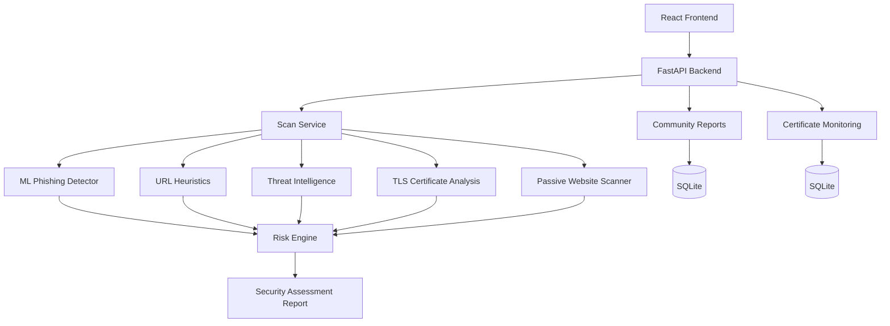

# CYBERNOVA

**AI-Powered Web Trust Intelligence Platform**

CYBERNOVA is a cybersecurity intelligence platform designed to assess suspicious URLs through multiple independent security signals. It combines machine-learning phishing detection, URL heuristics, threat intelligence, TLS certificate analysis, and passive website security checks into an explainable risk assessment.

> **Disclaimer:** CYBERNOVA is a security triage and educational demonstration tool. It does not guarantee that a website is safe or malicious.

## Overview

Users frequently encounter suspicious links and need evidence before deciding whether to trust them. CYBERNOVA brings multiple security signals together, explains its findings, and generates a printable security report.

The platform emphasizes:
- Explainable security findings
- Independent analysis components
- Transparent assessment coverage
- Conservative risk scoring
- Explicit reporting of unavailable intelligence sources

## Architecture



### Technology Stack

| Component | Technology |
|---|---|
| Frontend | React, Vite, JavaScript, CSS |
| Backend API | Python, FastAPI, Pydantic |
| Machine Learning | scikit-learn |
| Security Analysis | Python security services |
| Persistence | SQLite |
| Testing | pytest |
| Deployment | Vercel |

## Features

### URL Security Analysis
- ML-based phishing probability
- URL heuristic analysis
- Explainable risk score and trust score
- Component availability and assessment coverage
- Security findings and recommendations

### Threat Intelligence
- URLhaus integration
- PhishTank integration
- OpenPhish feed lookup
- Community threat-report signals
- Source-specific results and availability reporting

### Website Security Assessment
- TLS certificate validity and hostname checks
- Certificate chain and protocol assessment
- HTTP security-header analysis
- Redirect-chain inspection
- Cookie security checks
- HTTPS enforcement
- Bounded static mixed-content checks

### Certificate Monitoring
- Certificate fingerprint baselines
- Certificate change detection
- Historical observations
- Change severity and recommendations
- Scheduled certificate checks

### Community Reports
- Anonymous/pseudonymous report submission
- URL normalization and duplicate protection
- Moderation workflow
- Public privacy filtering
- Community threat signals

### Reports and Dashboard
- Security assessment dashboard
- Trust dashboard
- Scan history
- Printable security reports
- Browser Print / Save as PDF
- Responsive navigation

## Project Structure

```text
CYBERNOVA/
├── backend/
│   ├── api/
│   ├── data/
│   ├── intelligence/
│   ├── schemas/
│   ├── security_engine/
│   ├── services/
│   ├── main.py
│   ├── requirements.txt
│   └── requirements-dev.txt
├── frontend/
│   ├── public/
│   ├── src/
│   │   ├── components/
│   │   ├── pages/
│   │   ├── utils/
│   │   ├── App.jsx
│   │   ├── api.js
│   │   └── styles.css
│   ├── package.json
│   └── vite.config.js
├── tests/
├── .gitignore
└── README.md
```

## Requirements

- Python 3.9 or later
- Node.js and npm
- Network access for live DNS, website, TLS, and threat intelligence checks

Docker is not required for local development.

## Local Installation

### 1. Clone the repository

```bash
git clone https://github.com/abulbasar-04/NEXVOLT.git
cd NEXVOLT
```

### 2. Set up the backend

```bash
python3 -m venv backend/venv
source backend/venv/bin/activate

python -m pip install --upgrade pip
python -m pip install -r backend/requirements.txt
python -m pip install -r backend/requirements-dev.txt

cp backend/.env.example backend/.env
```

Edit `backend/.env` only when optional credentials or custom settings are required.

### 3. Set up the frontend

```bash
cd frontend
npm ci
cd ..
```

### 4. Start the backend

From the repository root:

```bash
source backend/venv/bin/activate
uvicorn main:app --app-dir backend --host 127.0.0.1 --port 8000
```

### 5. Start the frontend

Open another terminal:

```bash
cd NEXVOLT/frontend
npm run dev
```

Open:

- Frontend: http://localhost:5173
- API health: http://127.0.0.1:8000/api/health
- API documentation: http://127.0.0.1:8000/docs

## Configuration

Backend configuration is managed through environment variables and `backend/.env`.

| Variable | Purpose |
|---|---|
| `URLHAUS_AUTH_KEY` | Optional URLhaus authentication |
| `PHISHTANK_API_KEY` | Optional PhishTank API access |
| `OPENPHISH_FEED_URL` | OpenPhish feed URL |
| `COMMUNITY_REPORT_ADMIN_TOKEN` | Community moderation authentication |
| `COMMUNITY_REPORT_COOKIE_SECURE` | Secure reporter-cookie configuration |
| `COMMUNITY_REPORT_DATABASE` | Community-report SQLite database path |
| `CERTIFICATE_MONITOR_DATABASE` | Certificate-monitoring SQLite database path |
| `CERTIFICATE_MONITOR_INTERVAL_SECONDS` | Certificate monitoring interval |
| `VITE_API_BASE_URL` | Frontend API base URL |

The default local database paths are under `backend/data/`.

**Never commit `.env` files or expose backend credentials through `VITE_*` variables.** Vite environment variables are delivered to the browser.

## Testing

Run the backend tests:

```bash
source backend/venv/bin/activate
PYTHONPATH=backend python -m pytest -q
```

Additional checks:

```bash
python -m compileall -q backend tests
git diff --check
```

Build the frontend:

```bash
cd frontend
npm run build
```

The automated tests mock external intelligence and network responses. They do not require live malicious URLs.

## Deployment

### Frontend

- Live frontend: https://nexvolt-theta.vercel.app
- Framework: Vite / React
- Configure `VITE_API_BASE_URL` with the deployed backend URL before building.

### Backend

- Live API: https://nexvolt-br3o.vercel.app
- API health: https://nexvolt-br3o.vercel.app/api/health
- API documentation: https://nexvolt-br3o.vercel.app/docs

The backend uses FastAPI and is deployed on Vercel.

**Important:** SQLite is appropriate for local development and demonstrations. Vercel serverless filesystem storage is ephemeral and is not suitable for reliable persistent user data. Community reports and certificate-monitoring records require external persistent storage before production use.

## Demo Workflow

1. Start the backend and frontend.
2. Confirm that the frontend reports the CYBERNOVA API as connected.
3. Open the URL Scanner and test a harmless example domain such as `https://example.com/`.
4. Review the risk score, component coverage, threat intelligence, certificate details, and website findings.
5. Open the Trust Dashboard and Security Report.
6. Demonstrate Print / Save as PDF.
7. Optionally demonstrate certificate monitoring and community reporting using harmless example data.

Live results depend on network access and external provider availability.

## Security Considerations

- CYBERNOVA is a local, single-user hackathon demonstration, not a production multi-tenant security service.
- Backend scan and monitoring endpoints do not implement user authentication.
- Do not expose the backend publicly without appropriate authentication, rate limiting, abuse prevention, and security controls.
- Community moderation uses a shared bearer token.
- Community submission rate limiting is in-memory and per process.
- SQLite lock timeouts do not replace a production database.
- The certificate scheduler runs within the API process; use one worker per shared monitoring database.
- Website assessment is passive and does not execute JavaScript, authenticate, or submit forms.
- Threat intelligence providers may be unavailable, return no matches, or time out.
- Missing intelligence or a no-match result is not proof of safety.
- URLs may be sent to configured third-party intelligence providers and stored in browser-local scan history.
- Never submit URLs containing passwords, session tokens, personal information, or confidential data.
- HTTPS does not guarantee that a website is legitimate.

## Limitations

CYBERNOVA does not provide:
- A malware execution sandbox
- Complete certificate-transparency or revocation coverage
- Guaranteed detection of every phishing website
- A guarantee that a website is safe
- A substitute for professional security review

## Project Status

CYBERNOVA is an educational cybersecurity project demonstrating machine learning, threat intelligence integration, passive website analysis, API development, and security reporting.

---

**Built for cybersecurity learning, experimentation, and demonstration.**